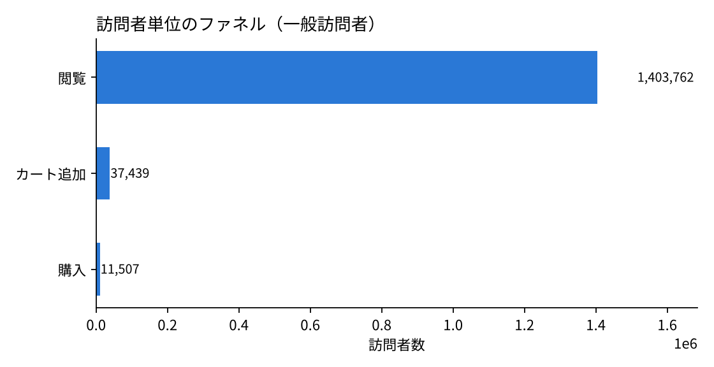
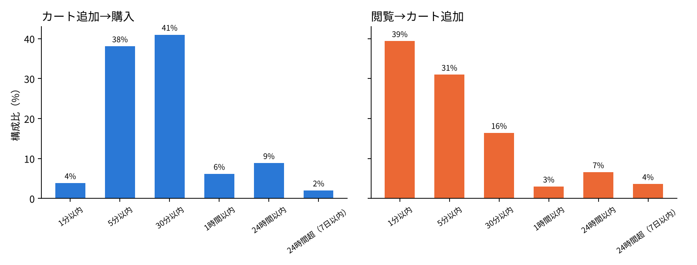
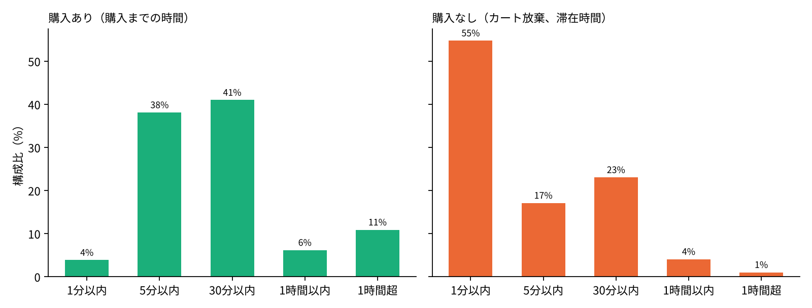
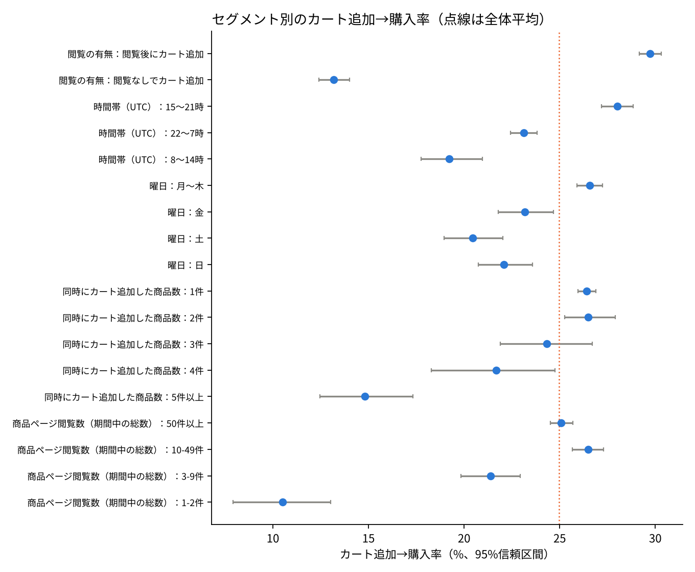
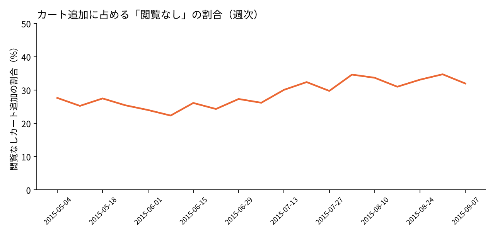
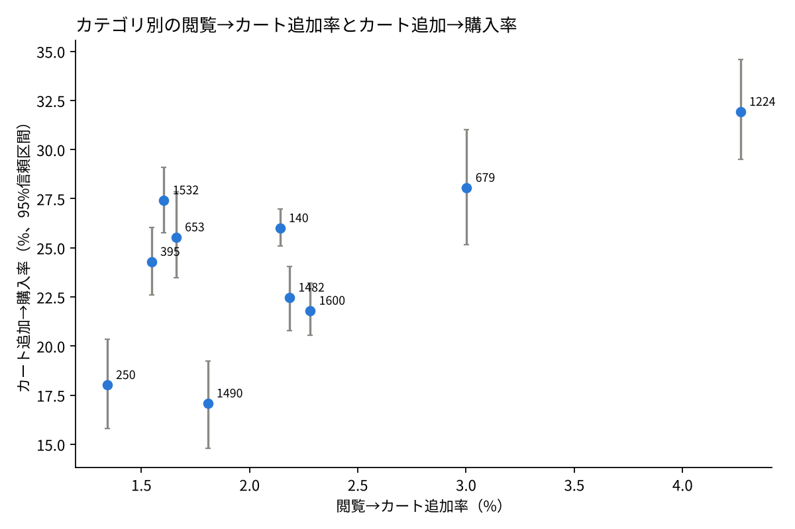
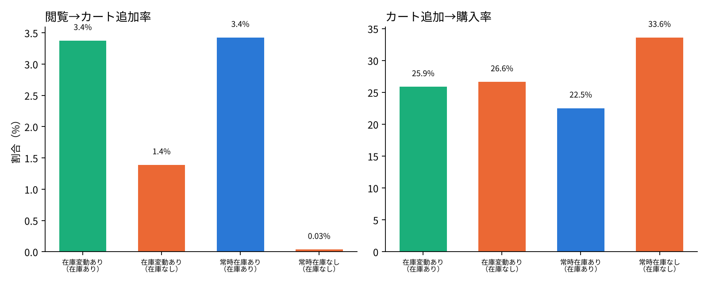

# ECサイト購買ファネル分析

## 目次

1. はじめに
   - 1.1 背景と目的
   - 1.2 分析の問い
   - 1.3 結論の要約
2. データと前処理
   - 2.1 データ概要
   - 2.2 データ品質の確認と前処理
   - 2.3 分析上の主要な定義
3. 分析結果
   - 3.1 ファネルの全体像
   - 3.2 各段階の所要時間と、カート追加後の滞在時間
   - 3.3 カート放棄後の再訪と購入
   - 3.4 カート追加後の購入率の差
   - 3.5 「閲覧なしのカート追加」の差の内訳
   - 3.6 カテゴリ別の購入率とカート追加率
   - 3.7 在庫状態の影響
4. 提案
   - 4.1 優先順位
   - 4.2 実行の進め方と効果検証
5. 限界と今後の課題
6. 付録
   - 付録A 用語・指標の説明
   - 付録B 分析手法
   - 付録C 補足分析・検証
   - 付録D ファイル構成と再現手順
   - 付録E 参考文献・データの出典

---

## 1. はじめに

### 1.1 背景と目的

本データでは、商品を閲覧した訪問者のうち、購入に至った割合は約0.8%であった。施策の対象を絞るには、購買ファネルのどの段階で離脱が多く発生しているかを把握する必要がある。

本分析は、行動ログ(閲覧・カート追加・購入)と商品属性(在庫フラグ・カテゴリ)を用いて、ファネルの離脱箇所と、離脱が多い条件を特定し、その差が他の条件や訪問者の違いを除いても残るかを確認したうえで、施策の優先順位を提示することを目的とする。

### 1.2 分析の問い

1. ファネルのどの段階で大きく離脱しており、カート追加後の行動はどの程度の時間で終わるか。
2. カート追加後の購入率は、どの条件で低いか。その差は他の条件や訪問者の違いを除いても残るか。
3. 在庫状態はファネルのどの段階に影響するか。

### 1.3 結論の要約

- ファネルで最も離脱が大きいのは「**閲覧→カート追加**」である。
- カート追加後の行動の大半は30分以内に記録される(解釈の限界は3.2節)。放棄されたカートが後から同一商品で購入される割合は小さい。
- カート追加後の購入率は、条件(時間帯・曜日・同時に追加した商品数・商品の人気度・閲覧の有無)によって差がある。ただし、時間帯・曜日の差は、訪問者の構成の違いを反映している可能性がある。
- 在庫なしの影響は「**閲覧→カート追加**」の段階に現れ、カート追加後の購入率には現れない。
- 417人の高頻度アクセス訪問者が購入の約29%を占める。一般訪問者とは別に扱う必要がある。

---

## 2. データと前処理

### 2.1 データ概要

Retailrocket 社が公開している E コマースデータセット(Kaggle: `retailrocket/ecommerce-dataset`)を用いた。期間は2015年5月3日〜9月18日(UTC)である。

| データ | 内容 | 規模 |
|---|---|---|
| events | 訪問者の行動ログ(閲覧、カート追加、購入) | 約276万件(完全重複460件を除去後)、訪問者約141万人、商品約23.5万点。購入は約2.2万件(購入者約1.2万人) |
| item_properties | 商品属性の履歴(在庫フラグ、カテゴリ等) | 約2,028万行、商品約41.7万点 |
| category_tree | カテゴリの階層 | 1,669カテゴリ(最上位25) |

### 2.2 データ品質の確認と前処理

| 確認結果 | 対応 |
|---|---|
| 完全重複のイベントが460件 | 除去 |
| 期間中のイベントが100件以上の訪問者(417人)は購入の28.9%を占め、カート追加後の購入率は63.3%と、一般訪問者(25.0%)の約2.5倍。業者による購入や自動化されたアクセスを含む可能性がある | 「高頻度アクセス訪問者」として分け、以降は断りがない限り一般訪問者を対象とする。閾値の感度分析は付録C.6 |
| 在庫フラグ(`available`)は約1週間間隔のスナップショットである。行動ログに現れる商品のうち約21%(約5.0万点)は、商品属性に記録がない | イベント時点の在庫状態を履歴から判定する。記録のない商品は、在庫状態別の比較で別に示す(3.7節) |
| 時刻はUTCであり、サイトの現地時間帯は不明 | UTCのまま集計する |

### 2.3 分析上の主要な定義

- **分析単位**: 「訪問者×商品」とする。
- **追跡期間**: 起点(訪問者×商品ごとの初回の閲覧、または初回のカート追加)から7日以内の行動を追跡する。追跡期間を全件で確保するため、ログ最終時刻の7日前までに起点がある組に限定した。7日で足りるかは付録C.1で確認した。
  - 閲覧起点:初回の閲覧から7日以内のカート追加・購入の有無(1,955,445組)
  - カート起点:初回のカート追加から7日以内の同一商品の購入の有無(50,704組)
- **カート放棄**: カート追加から24時間以内に同一商品を購入しなかったカート。
- **条件間の差の確認**: まず単純に比べ、次に同一商品内・同一訪問者内に比較の範囲を絞って、差が残るかを確認する。信頼区間は訪問者単位のブートストラップで求めた。詳細は付録Bを参照。

---

## 3. 分析結果

### 3.1 ファネルの全体像

> 要点：ファネルで最も離脱が大きいのは「閲覧→カート追加」である。

一般訪問者のうち、カートに商品を入れたのは2.7%、購入に至ったのは0.8%であった。購入者数はカート追加者数の約3割(30.7%)にあたる。ここでの購入者には、カートを経ずに購入した訪問者も含まれる。

訪問者×商品の単位では、閲覧からカート追加に進む割合は1.8%で、購入は0.6%である。この単位でのカート追加後の購入率は25.0%となり、訪問者単位(30.7%)より低い。訪問者単位は商品を問わず購入を数えるのに対し、訪問者×商品の単位は同一商品の購入だけを数えるためである。

### 3.2 各段階の所要時間と、カート追加後の滞在時間

> 要点：カート追加後の行動の大半は30分以内に記録される。ただし、購入へ誘導できる時間が短いとまでは言えない。

閲覧からカート追加までは、追加した組の約7割が5分以内、約9割が30分以内に進んでいる。カート追加から購入までは、購入の約8割(83%)が30分以内、約9割が1時間以内に起きている。

この分布は購入した組だけのものである。購入しなかった組については、カート追加から同じセッションで最後に記録された行動までの時間を滞在時間とし、購入までの時間と並べた。

購入しなかった組の約55%は、カート追加から1分以内に最後の行動が記録され、約72%が5分以内、約95%が30分以内である。ただし、滞在時間は最後の行動までの時間であり、最後のページを見ていた時間を含まない下限である。また、セッションを30分間隔で区切っているため、30分以内に収まりやすい。この時間に絞った施策が購入を増やすかは、この分析からは分からない。

### 3.3 カート放棄後の再訪と購入

> 要点：放棄されたカートが後から同一商品で購入される割合は0.7%と小さい。

カート追加から24時間以内に購入されなかったカートを「カート放棄」とした(38,295組)。放棄されたカートの約27%は、1時間後以降に何らかの行動で再訪しているが、同一商品を7日以内に購入した割合は0.7%、他の商品を含めて何らかの購入をした割合は4.6%にとどまる。再訪は購入にほとんど結びついていない。

### 3.4 カート追加後の購入率の差

> 要点：カート追加後の購入率は、条件によって差がある。ただし、時間帯・曜日の差は、訪問者の構成の違いを反映している可能性がある。

一般訪問者のカート追加後の購入率は全体で25.0%である。条件別の差は図のとおりである。

- **時間帯**：UTC15〜21時が最も高く、8〜14時が最も低い。
- **曜日**：月〜木が最も高く、金・土・日は低い。土曜が最も低い。
- **同時にカート追加した商品数**：同一の1時間内に5件以上をカート追加した場合に低い。商品を比較・保存する目的でカートを使っている可能性がある。
- **商品ページ閲覧数**：期間中の閲覧が2件以下の商品で低い。3件以上では調整後に差がほぼ消える。
- **閲覧の有無**：閲覧後にカート追加した場合は29.7%、閲覧なしで追加した場合は13.2%で、最も差が大きい。3.5節で扱う。

これらの条件を同時に調整するロジスティック回帰でも傾向は変わらなかった(付録C.2)。ただし、この調整は訪問者ごとの違いを取り除かない。そこで、同じ訪問者が両方の条件でカートを持つケースに限り、訪問者内で比較した(付録C.3)。時間帯・曜日の差は同一訪問者内では確認できず、その時間帯・曜日に訪れる訪問者の構成の違いを反映している可能性がある。閲覧の有無による差は縮小し、同時にカート追加した商品数と商品ページ閲覧数の差は残った。

### 3.5 「閲覧なしのカート追加」の差の内訳

> 要点：閲覧なしのカート追加は購入率が低いが、その差の大半は、経路そのものよりも訪問者の違いによる。

カート追加の約29%は、ログ上、同一商品の閲覧が先行していない。この割合は5月は25〜28%程度だったが、8月には31〜35%程度に増えている。

購入率の差(閲覧後が閲覧なしの約2.3倍)が、経路そのものによるのか、訪問者の違いによるのかを確認した。

| 比較の方法 | 購入率の比(閲覧後 ÷ 閲覧なし) |
|---|---|
| 単純比較 | 2.25倍 |
| 同一商品内で比較 | 1.98倍(95%信頼区間 1.86〜2.11) |
| 同一訪問者内で比較 | 1.16倍(95%信頼区間 1.10〜1.22) |

同一商品内では差が残るが、同一訪問者内では1.16倍まで縮小する。すべてのカートが閲覧なしの訪問者(7,102人)の購入率は9.7%、すべて閲覧後の訪問者(26,404人)は30.6%であり、閲覧せずに追加する訪問者層は、比較検討や保存のためにカートを使うなど、購入の意図が異なる可能性がある。同一訪問者内の比較は、両方の経路があった訪問者(2,358人)のみが対象である。

### 3.6 カテゴリ別の購入率とカート追加率

> 要点：カテゴリ250と1490はカート追加後の購入率が特に低く、1600と1482も全体を下回る。1224は閲覧→カート追加率、カート追加後の購入率の両方が高い。

最上位カテゴリのうち、閲覧が2万組以上かつカート追加が1,000件以上ある10カテゴリについて、「閲覧→カート追加率」と「カート追加→購入率」を比べた。他のカテゴリは、信頼区間が広くなるため対象外とした。

カート追加後の購入率は、カテゴリ250(18.0%、95%信頼区間 15.8〜20.4%)と1490(17.1%、14.8〜19.2%)で特に低い。1600(21.8%、20.5〜23.2%)と1482(22.5%、20.8〜24.0%)も、信頼区間の上限が全体の25.0%を下回る。カテゴリ1224は31.9%(29.5〜34.6%)と高く、閲覧→カート追加率(4.3%)も他より高い。残る5カテゴリは24〜28%で、全体との差は小さい。カテゴリIDは匿名化されており、購入率が低い理由は、このデータからは分からない。

### 3.7 在庫状態の影響

> 要点：在庫なしの影響は「閲覧→カート追加」の段階に現れ、カート追加後には現れない。

在庫フラグの履歴から各イベント時点の在庫状態を判定し、商品を、期間を通じて常に在庫ありの商品、常に在庫なしの商品、在庫が切り替わる商品の3つに分けた。閲覧された「訪問者×商品」のうち、約32%は常時在庫なしの商品、約7%は在庫変動商品の在庫なし期間のものであった。約11%は商品属性に記録がない商品である。ただし、在庫フラグには誤判定が含まれている可能性がある(付録C.4)。

在庫状態別に段階ごとの割合を見ると、差は「閲覧→カート追加」の段階に集中している。在庫変動商品では、閲覧→カート追加率が在庫なし期間で1.4%、在庫あり期間で3.4%であり、常時在庫なしの商品は0.03%である。

影響の大きさは、比較の方法で大きく変わる。次の比は、いずれも在庫ありの率を在庫なしの率で割った値であり、1より大きいほど在庫なしで低い。

| 段階 | 比較の方法 | 比 |
|---|---|---|
| 閲覧→カート追加 | 単純比較(全商品) | 約10.8倍 |
| 閲覧→カート追加 | 同一商品内 | 1.96倍(95%信頼区間 1.85〜2.08) |
| 閲覧→カート追加 | 同一訪問者内 | 1.24倍(1.15〜1.33) |
| カート追加→購入 | 単純比較(全商品) | 0.91倍(0.85〜0.97) |
| カート追加→購入 | 同一商品内 | 0.90倍(0.82〜0.98) |

単純比較で大きく出るのは、そもそも購入されにくい常時在庫なしの商品が含まれるためである。同一商品内、同一訪問者内に絞ると比は縮小するが、在庫なし期間は閲覧→カート追加率が低い。一方、カート追加後の購入率の比は0.9倍前後で、在庫なしのカートの購入率は在庫ありと同程度か、やや高い。

在庫なしの商品が、訪問者の離脱の要因にもなっているかを確認するため、訪問者が期間中に最初に閲覧した商品(最初のイベントが閲覧である訪問者が対象)に注目した。最初の閲覧のうち、約38%は常時在庫なしの商品であった。最初の閲覧の後に追加の行動がなかった訪問者の割合は、常時在庫なしの商品で79.4%、常時在庫ありの商品で65.9%と、前者のほうが高い。ただし、属性情報のない商品では85.5%とさらに高く、すでに販売されていない商品や古いリンクからの流入など、在庫以外の要因が関わっている可能性が大きい。この比較は商品の違いを調整していないため、在庫なしが原因とは言えない(同一商品内の比較は付録C.5)。

---

## 4. 提案

### 4.1 優先順位

本分析の結果から導いた6件の施策に、次の3つの基準を①、②、③の順に優先して、1〜6の順位を付けた。

| 基準 | 内容 |
|---|---|
| ① 根拠の確からしさ | ◎：同一商品内・同一訪問者内に絞っても差が残る。○：信頼区間で差は確認できるが、訪問者や商品の違いは除けていない(または対象が少数)。△：差や課題は確認できるが、原因や効果の切り分けが不十分。×：差が他の要因で説明できる可能性が大きい |
| ② 規模・効果の目安 | 購入数への影響の試算(方法は付録B)。試算できないものは「推定できない」「推定していない」とした |
| ③ 着手の前提 | 着手前に追加の確認やデータ整備が必要か。不要なものを先にした |

| 順位 | 施策 | ① 根拠の確からしさ | ② 効果の目安 | ③ 前提・留意点 |
|---|---|---|---|---|
| 1 | 在庫変動商品の在庫なし期間に、在庫のある代替商品を提示する(在庫なし表示の見直しを含む) | ◎ 同一商品内(1.96倍)、同一訪問者内(1.24倍)でも、在庫なし期間は閲覧→カート追加率が低い(3.7節) | カート追加が1.3〜5.1%、購入が0.9〜3.8%増える | 在庫フラグの意味の確認が前提。代替商品の提示が実際に閲覧→カート追加率を上げるかは、ABテストで確認する |
| 2 | カテゴリ250・1490・1600・1482のカート追加後の導線(購入手続き、商品ページの構成)を、購入率が高い1224と比較して改善する | ○ 4カテゴリは、購入率の信頼区間の上限が全体平均を下回る(3.6節) | 購入が約4.1%増える | 追加の確認は不要。購入率が低い理由はデータから分からない |
| 3 | 同時にカートへ入れた商品が多い訪問者向けに、カート内の比較・絞り込みを支援する | ○ 同一訪問者内でも差が残ったが、対象訪問者が少ない(3.4節、付録C.3) | 同時にカート追加した商品数が5件以上のカートで、購入が約4.0%増える | 追加の確認は不要。保存目的でカートを使う訪問者が多い場合、効果は小さい |
| 4 | カート追加後30分程度の導線を改善する(決済画面の入力負担の軽減、離脱時の声かけ) | △ 購入の約8割が30分以内に起きるが、施策が購入を増やすかは分からない(3.2節) | 推定できない | 追加の確認は不要。既存の働きかけの有無が不明なため、ABテストで判断する(3.3節) |
| 5 | 高頻度アクセス訪問者を別のセグメントとして扱う(一般訪問者向け施策の効果測定から除外する) | △ 417人が購入の約3割を占めるが、業者や自動化かは分からない(2.2節) | 推定していない | 追加の確認は不要 |
| 6 | 常時在庫なしの商品ページを整理する(非表示、販売終了の案内、類似商品への誘導) | × 最初の閲覧の後に離れる割合は高いが、商品の違いを調整しておらず、同一商品内の差は小さい(付録C.5) | 推定できない(閲覧の約3分の1が対象) | 在庫フラグの意味の確認が前提。販売終了など在庫以外の要因の可能性がある |

順位は①〜③を順に当てはめた相対的なもので、効果の大きさの順ではない。②の試算は施策ごとに前提が異なり、厳密には比較できない。第2位と第3位の試算は同程度で、順位の差は小さい。第4位と第5位も、いずれも①が△で差は小さい。商品ページ閲覧数が2件以下の商品は購入率が低い(3.4節)が、対象のカートが743件(試算で購入約0.8%)と少なく、改善の手がかりもデータにないため、施策には含めなかった。

### 4.2 実行の進め方と効果検証

第1位と第6位は、在庫フラグの意味(実在庫か販売状態か)の確認が前提となるため、最初にデータ提供元・サイト運営側へ確認する。第2位〜第5位は、これと並行して着手できる。

施策には含めていないが、「閲覧なしのカート追加」の発生元(カート追加が行われた画面)をログに記録することが望ましい。この区分はカート追加の約3割を占め、増加傾向にあるが、現状のデータでは原因が特定できず、施策を設計できない。発生元が分かれば、購入が2.4〜13.6%増える余地(付録B)を施策に結びつけられる。

各施策は、実施前にABテスト等で効果を検証する。分析データ上の試算は購入件数のみの評価であり、価格・売上のデータがないため、売上への影響は評価していない。

---

## 5. 限界と今後の課題

**限界**

- 比較はいずれも観察データに基づく関連であり、因果効果ではない。同一商品内・同一訪問者内の比較は交絡の一部を除くが、すべては除けない。
- 訪問者内比較は、両方の条件でカートを持つ訪問者(156〜370人)に限られ、信頼区間が広い。
- 在庫フラグの精度は付録C.4、カート追加後の滞在時間の解釈は3.2節に記した。
- データには、カート放棄後のリマインド等の働きかけの有無を示す情報がない。データ提供元のRetailrocket社はカート放棄時のメール通知を提供する事業者であり(付録E)、同様の働きかけが行われていた可能性がある。その場合、3.3節の値には働きかけの効果が含まれる。
- 「閲覧なしのカート追加」には、一覧画面等からの追加のほか、訪問者IDの切り替わりなどによる計測上の欠落が含まれる可能性があり、原因は特定できない。
- 時刻はUTCで現地時間帯は不明、カテゴリIDは匿名化されている。期間は約4.5か月で、季節変動は評価できない。

**今後の課題**

- 働きかけの有無、カート追加が行われた画面、現地時間帯、価格・売上のデータがあれば、カート放棄後の施策の効果、閲覧なしのカート追加の実態、在庫の影響をより直接的に検証できる。

---

## 6. 付録

### 付録A 用語・指標の説明

| 用語・指標 | 説明 |
|---|---|
| 訪問者×商品 | 同じ訪問者が同じ商品に対して行った一連の行動のまとめ。本分析のファネルの単位 |
| 追跡期間 | 起点(訪問者×商品ごとの初回の閲覧、または初回のカート追加)から行動を観察する期間。本分析では7日 |
| 閲覧→カート追加率 | 閲覧した組のうち、追跡期間内に同一商品をカートに追加した組の割合 |
| カート追加→購入率 | カートに追加した組のうち、追跡期間内に同一商品を購入した組の割合。本文では「カート追加後の購入率」とも記す |
| カート放棄 | カート追加から24時間以内に同一商品を購入しなかったカート。一般的な「カゴ落ち」より期間を限定した、本分析の定義 |
| セッション | 同じ訪問者のイベントのうち、前後の間隔が30分以内のものをひとまとまりとしたもの |
| 滞在時間(カート追加後) | カート追加から、同じセッションで最後に記録された行動までの時間 |
| 最初の閲覧 | 訪問者が期間中に最初に行った閲覧(最初のイベントが閲覧である訪問者のみが対象)|
| 閲覧なしのカート追加 | ログ上、カート追加より前に同一商品の閲覧がないカート追加 |
| 同時にカート追加した商品数 | 同じ訪問者が、同一の1時間内にカートへ追加した商品の数 |
| 商品ページ閲覧数 | 期間中に、その商品のページが閲覧された総数(全訪問者の合計) |
| 高頻度アクセス訪問者 | 期間中のイベントが100件以上の訪問者。一般訪問者と行動が大きく異なるため分離した |
| 在庫フラグ | 商品属性 `available`。1が在庫あり、0が在庫なし。約1週間間隔で記録される |
| 常時在庫あり / 常時在庫なし / 在庫変動あり | 期間を通じた在庫フラグの動き方による商品の分類 |
| 単純比較 | 商品や訪問者を絞らず、全体で条件ごとの率を比べた値 |
| 商品内比較 / 訪問者内比較 | 同一商品の中、または同一訪問者の中で条件を比べる方法。商品や訪問者の違いによる影響を除く。層ごとの比を重み付き平均でまとめる(Mantel-Haenszel型の推定量) |
| ロジスティック回帰 | 購入の有無のような2値の結果に対し、複数の条件の影響を同時に推定する回帰分析。結果はオッズ比で示す |
| オッズ比 | 他の条件を一定としたときの購入されやすさ(オッズ)の比。1より小さいと購入されにくい |
| 95%信頼区間 | 同じ手順でデータを取り直して区間を繰り返し作ると、その95%が真の値を含むように設計された区間。訪問者単位のブートストラップ(標本の再作成の繰り返し)で算出 |

### 付録B 分析手法

- **集計・結合**: テーブル構築と集計は SQL(DuckDB)、信頼区間・回帰・図表は Python で行った。コードは `sql/`、`python/` に格納している。
- **追跡期間**: 購入・カート追加の判定は、起点の時刻ではなく、追跡期間内のイベントを直接結合して行った(2.3節)。
- **信頼区間**: 同一訪問者が複数のカートを持つことを考慮し、訪問者単位のブートストラップ(1,000回、乱数シード固定)で求めた。ロジスティック回帰も、訪問者単位のクラスタ頑健標準誤差を用いた。
- **効果の目安の試算**: 購入数の増加を、現在のカート起点の購入数(12,665件)に対する割合で示した。いずれも訪問者の違いを調整しない単純な試算であり、実際の効果はより小さい可能性がある。
  - 在庫: 在庫変動商品の在庫なし期間の閲覧が、在庫あり期間と同じ水準でカート追加に至ると仮定した場合のカート追加の増加。同一訪問者内の比(1.24倍)で約450件、同一商品内の比(1.96倍)で約1,840件であり、閲覧起点のカート追加全体の1.3〜5.1%にあたる。購入は、増えたカート追加が在庫あり期間のカート追加後の購入率(25.9%)で購入に至ると仮定し、約120〜480件(0.9〜3.8%)とした。
  - カテゴリ: 購入率の信頼区間の上限が全体平均を下回る4カテゴリが、全体平均(25.0%)まで上がった場合の購入増(約520件、4.1%)。
  - 同時にカート追加した商品数: 5件以上のカートの購入率が全体平均まで上がった場合の購入増(約500件、4.0%)。
  - 閲覧なしのカート追加: 購入率が全体平均まで上がった場合(上限、約13.6%)と、同一訪問者内の比(1.16倍)まで上がった場合(下限、約2.4%)の購入増。

### 付録C 補足分析・検証

#### C.1 追跡期間7日の妥当性(2.3節)

24時間を過ぎたカートの購入がどの程度続くかで確認した。ログ最終の14日前までにカート追加があり、24時間以内に購入されなかったカート36,317件のうち、24時間〜7日の間に同一商品が購入されたのは242件、7〜14日の間は67件であった。7日を超えて追跡しても、増える購入は少ない。

#### C.2 ロジスティック回帰の結果(3.4節)

カート追加後の購入の有無を結果とし、時間帯・曜日・同時にカート追加した商品数・閲覧の有無・商品ページ閲覧数を同時に調整した。

| 条件(括弧内は比較の基準) | オッズ比 | 95%信頼区間 |
|---|---|---|
| UTC22〜7時(UTC15〜21時) | 0.78 | 0.74〜0.83 |
| UTC8〜14時(UTC15〜21時) | 0.62 | 0.56〜0.69 |
| 金曜(月〜木) | 0.85 | 0.78〜0.92 |
| 土曜(月〜木) | 0.74 | 0.67〜0.82 |
| 日曜(月〜木) | 0.79 | 0.73〜0.86 |
| 同時にカート追加した商品数が5件以上(1件) | 0.72 | 0.59〜0.87 |
| 閲覧なしのカート追加(閲覧後) | 0.38 | 0.36〜0.41 |
| 商品ページ閲覧数が2件以下(50件以上) | 0.48 | 0.37〜0.64 |

同時にカート追加した商品数が4件(0.96、0.78〜1.18)と、商品ページ閲覧数が3〜9件(0.95、0.86〜1.05)は、信頼区間が1を含むため上の表に載せていない。

#### C.3 同一訪問者内での比較(3.4節)

C.2の調整は、訪問者ごとの違いを取り除くものではない。そこで、同じ訪問者が両方の条件でカートを持つケースに限り、訪問者内で購入率を比べた。

| 比較(基準側 ÷ 比較側) | 対象訪問者数 | 単純比較 | 訪問者内比較(95%信頼区間) |
|---|---|---|---|
| UTC15〜21時 ÷ UTC8〜14時 | 188人 | 1.46倍 | 0.93倍(0.77〜1.14) |
| 月〜木 ÷ 土・日 | 370人 | 1.25倍 | 0.93倍(0.75〜1.14) |
| 同時にカート追加した商品数が1件 ÷ 5件以上 | 168人 | 1.78倍 | 1.29倍(1.01〜1.62) |
| 商品ページ閲覧数が50件以上 ÷ 2件以下 | 156人 | 2.39倍 | 1.66倍(1.15〜2.82) |

比が1を超えるほど、基準側の購入率が高い。

時間帯と曜日の差は、同一訪問者内では確認できなかった。比は0.93倍で、信頼区間が1を含む。ただし区間は広く(下限は0.75〜0.77)、2割強の差までは否定できないため、差がないとは言えない。同時にカート追加した商品数と商品ページ閲覧数の差は、縮小しつつも残った。ただし対象は両方の条件でカートを持つ少数の訪問者に限られ、信頼区間は広い。訪問者の違いを完全に取り除いた結果とは言えず、結果を全体に当てはめることもできない。

#### C.4 在庫フラグの精度(3.7節)

在庫フラグが判明している購入20,008件のうち、1,423件(7.1%)は、在庫なしと記録された状態で起きている。そのうち423件は次のスナップショットでも在庫なしであり、159件は常時在庫なしの商品の購入である。在庫フラグは約1週間間隔のスナップショットであり、イベント時点の状態とずれている可能性がある。また、常時在庫なしの商品が閲覧の約32%を占めることから、`available` が実在庫か販売状態かは不明である。誤判定があれば、3.7節の在庫なしの影響は実際より小さく推定されている可能性がある。

#### C.5 最初の閲覧後の行動と在庫の関係(3.7節)

在庫変動商品の中で、同一商品の在庫なし期間と在庫あり期間を比べると、最初の閲覧の後に追加の行動がなかった割合の比(在庫なし期間 ÷ 在庫あり期間)は1.09倍で、差は小さい。商品の違いを除くと、最初の閲覧の後に離れる割合に在庫の差はほとんど見られない。

#### C.6 高頻度アクセス訪問者の閾値の感度分析(2.2節)

高頻度アクセス訪問者(417人)は、イベント数の5.8%、カート追加の15.3%、購入の28.9%を占める。閾値(100件)を30〜200件の範囲で変えても、一般訪問者のカート追加後の購入率(24.5〜25.3%)と、閲覧なしのカート追加の購入率(12.2〜13.4%)は大きく変わらなかった。

#### C.7 検証

主要な数値(訪問者単位のファネル、カート起点・閲覧起点の件数、閲覧なしカート追加の割合)は、SQLとは別にPython(pandas)のみで再計算し、一致することを確認した。

### 付録D ファイル構成と再現手順

README を参照。元データはリポジトリに含めていない。

### 付録E 参考文献・データの出典

- Retailrocket, "E-commerce dataset", Kaggle(https://www.kaggle.com/retailrocket/ecommerce-dataset)。
- Retail Rocket, "Triggered emails for furniture online-shop HOFF"(https://retailrocket.net/blog/cases/triggered-emails-furniture-online-shop-hoff-ru)。データ提供元がカート放棄時のメール通知を提供していることの確認に用いた(5章)。
